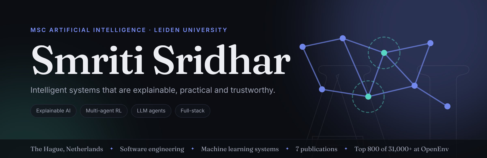
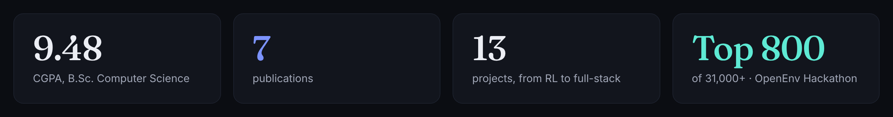
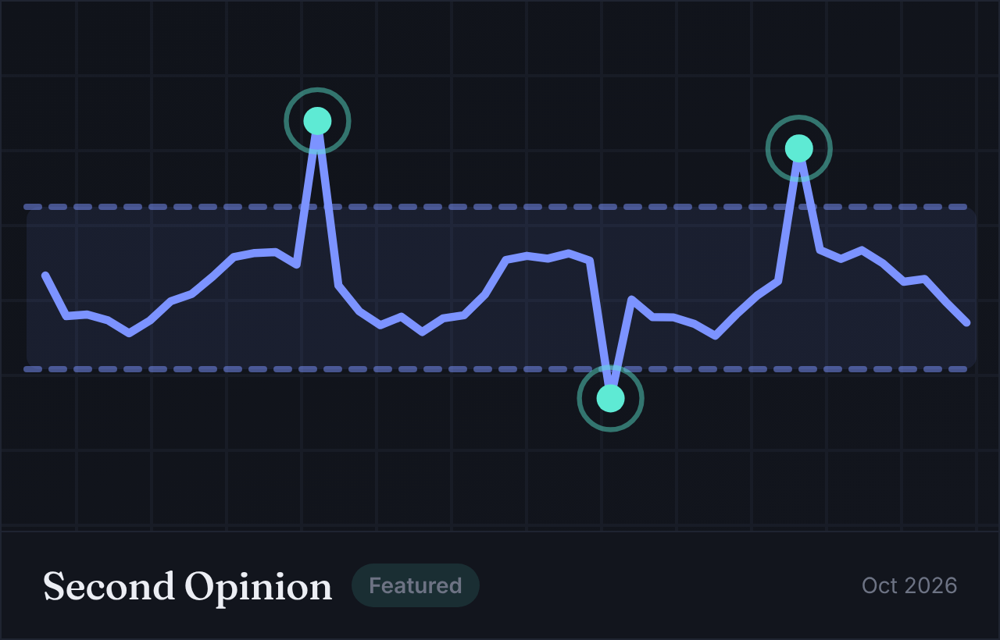
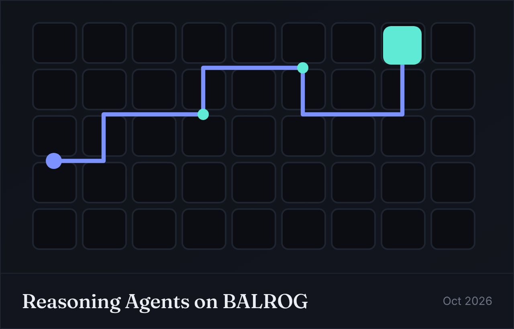
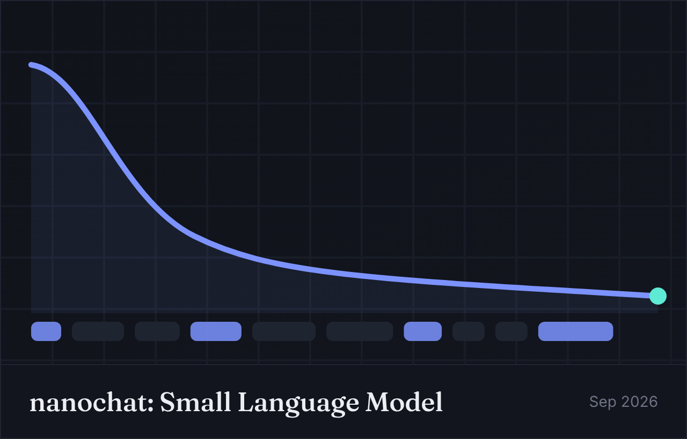
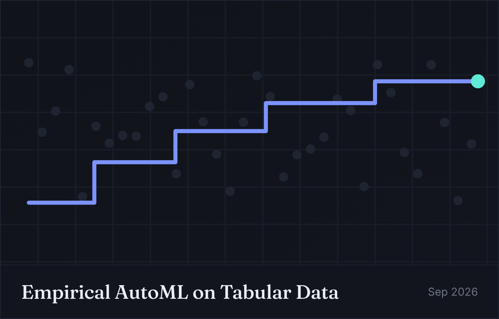
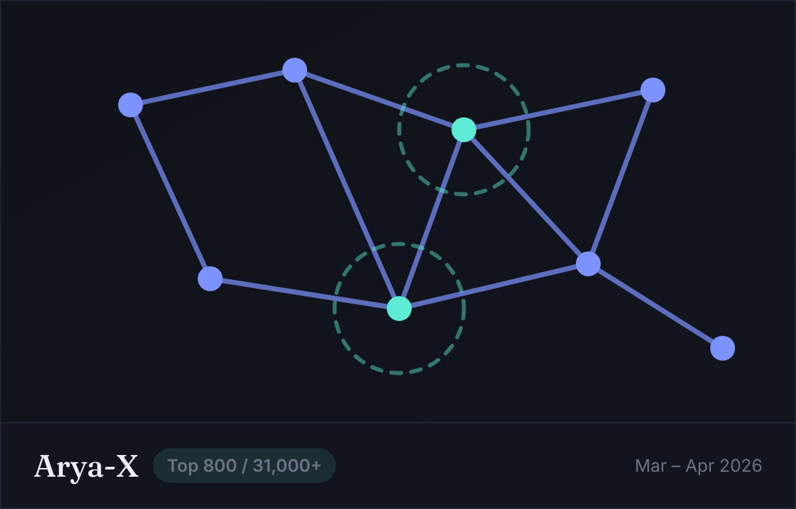
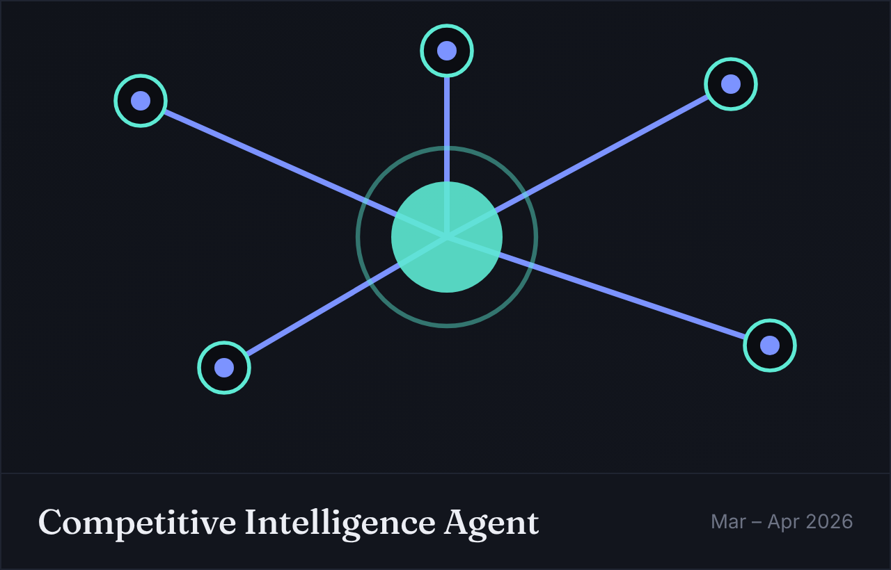
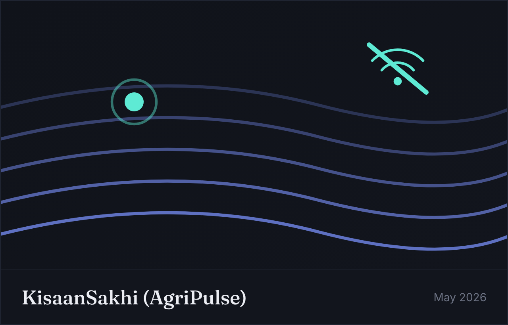
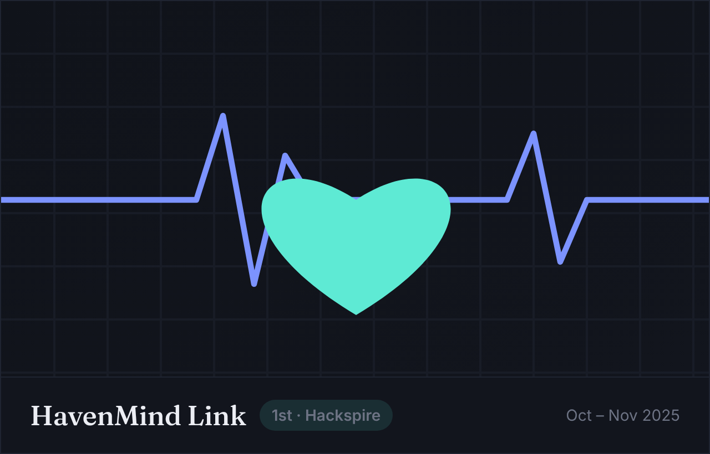

<!-- Update the Portfolio link below if your live site URL changes (e.g. your Firebase address). -->

<a href="#about">About</a> · <a href="#projects">Projects</a> · <a href="#research">Research</a> · <a href="#experience">Experience</a> · <a href="#education">Education</a> · <a href="#tech-stack">Tech stack</a> · <a href="#honours--awards">Awards</a> · <a href="#contact">Contact</a>

---
I'm an MSc Computer Science (Artificial Intelligence) student at Leiden University and a software engineer who likes systems that are explainable, practical and trustworthy: multi-agent reinforcement learning, LLM agents, anomaly detection, and full-stack products used by real people. This profile mirrors my portfolio.

About
Studying: MSc Computer Science, AI specialisation, Leiden University (Sep 2026 – Aug 2028). Completed B.Sc. Computer Science at M.O.P. Vaishnav College for Women (CGPA 9.481/10, Best Outgoing Student 2026) and currently pursuing B.Sc. Data Science and Applications at IIT Madras (GPA 8.59/10, expected May 2027).
Industry: five months shipping production backend systems for real clients, including PostgreSQL schema design, payment integration and AI workflow automation.
Research: 7 publications across explainable AI, neuromorphic computing, cybersecurity and fintech.
Recognition: Finalist (Top 800 of 31,000+) at the Meta × PyTorch × Hugging Face OpenEnv Hackathon, 1st place at Hackspire 2025.
Interests: Explainable AI, multi-agent systems, reinforcement learning, NLP, edge AI and neuromorphic computing, student wellbeing technology.
Looking for: working-student roles in software engineering, AI/ML and data-driven development in the Netherlands.
---
Projects
Most recent first. The full list, with details, is on the portfolio.
Featured: Second Opinion
<table>
<tr>
<td width="52%" valign="top">

</td>
<td width="48%" valign="top">

<b>AI-assisted decision support for wastewater monitoring.</b> An open-source, human-in-the-loop tool that helps wastewater treatment plant operators spot unusual sensor readings and decide which need attention first. The operator always makes the final call.

<ul>
<li>Context-aware detection against a 28-day historical baseline</li>
<li>Sensor-issue detection for stuck, zero and negative readings</li>
<li>Case prioritisation per plant, plus an unsupervised Isolation Forest ranking</li>
<li>Explainable dashboard in English and Dutch</li>
</ul>

<a href="https://github.com/Second-Opinion-Dev/Second_Opinion">GitHub</a> · <a href="https://second-opinion-dev.github.io/Second_Opinion/">Website</a> · <a href="https://second-opinion-dev.github.io/Second_Opinion/watch/">Video demo</a>

</td>
</tr>
</table>
Built in a team at the AI for Water Hackathon (28 Oct 2026, organised by AISO and the University of Amsterdam) on real operational data from TAI, part of Croonwolter&dros, with no labelled anomalies available.
More projects
<table>
<tr>
<td width="50%" valign="top">

<b>Self-reflection agents benchmarked on BabyAI.</b> Naive, planning-memory and actor-critic agents, run with a local and a cloud model. Self-reflection lifted Gemini from 84% to 88% success while planning memory dropped it to 60%. Includes an interactive Experiment Atlas. Python · Ollama · Gemini API · BALROG

</td>
<td width="50%" valign="top">

<b>End-to-end small language model.</b> 8K vs 32K BPE vocabularies, a 12.98M-parameter Transformer pretrained from scratch, and two-stage SFT, evaluated on ARC and GSM8K. PyTorch · SFT · BPE tokenization

</td>
</tr>
<tr>
<td width="50%" valign="top">

<b>Empirical AutoML on tabular data.</b> Random Search vs Optuna TPE vs Hyperband across five OpenML datasets plus TabPFN v2, in 60 runs. Hyperband took covertype from 91.01% to 93.55% balanced accuracy. Python · scikit-learn · Optuna · TabPFN v2

</td>
<td width="50%" valign="top">

<b><a href="https://github.com/smritis21/arya">Arya-X</a>: multi-agent RL for sensor coordination.</b> Conflict-aware negotiation and GRPO-tuned Qwen models: +79% cumulative reward, −50% conflict rate, +30% coordination. Finalist, Top 800 of 31,000+. PyTorch · Hugging Face · GRPO · Qwen

</td>
</tr>
<tr>
<td width="50%" valign="top">

<b><a href="https://github.com/smritis21/ci-agent">Competitive Intelligence Agent</a>.</b> Parallel Groq-powered reasoning agents with long-term vector memory and hindsight retrieval turn market signals into strategy. Python · Groq API · Vector databases

</td>
<td width="50%" valign="top">

<b><a href="https://github.com/smritis21/KisaanSakhi">KisaanSakhi (AgriPulse)</a>.</b> Field-force optimisation for agricultural sales teams in low-connectivity regions: XGBoost visit prioritisation, an offline-first React Native app and real-time anomaly scoring. XGBoost · React Native · FastAPI

</td>
</tr>
<tr>
<td width="50%" valign="top">

<b><a href="https://github.com/smritis21/HavenMind-Link">HavenMind Link</a>.</b> Student mental-health platform with real-time cognitive load analysis, crisis escalation, anonymous peer support and HIPAA-aligned privacy safeguards. 1st place, Hackspire 2025. Flask · Gemini · NLP · Sentiment analysis

</td>
<td width="50%" valign="top">

<b>Also on GitHub</b>

<ul>
<li><a href="https://github.com/smritis21/Appartment-Association">Apartment Association System</a>: team platform with FastAPI, RBAC and a confirm-before-change AI assistant</li>
<li><a href="https://github.com/smritis21/hospital-management-mad2">Hospital Management System V2</a>: Flask, Vue.js, Celery and Redis</li>
<li><a href="https://github.com/smritis21/MIIT-KERNEL">Stinder</a>: AI study-partner matching</li>
<li><a href="https://github.com/smritis21/ResQNet">ResQNet</a>: SOS emergency platform</li>
<li><a href="https://github.com/smritis21/quiz-master">Quiz Master</a> · <a href="https://github.com/smritis21/JobReadyX">JobReadyX</a></li>
</ul>
</td>
</tr>
</table>
---
Research
Seven publications, most recent first. Work under review: DeepFakeShield (transfer learning with explainable AI), Alzheimer's stage classification from MRI, and cash vs. UPI usage with machine learning.
Date	Paper	Venue	ISBN / ISSN
Feb 2026	Explainable Behavioural Stress Modelling for Student Wellbeing: The QARM-SL Framework and HavenMind Link Platform	ICCCMIT 2026 Proceedings. Highest Evaluation Score in Session	`978-81-990629-8-6`
Jan 2026	A Neuromorphic-Inspired Hybrid Edge AI Framework for Energy-Efficient Real-Time Intelligence	AI-Driven Digital Futures: Leveraging Intelligent Systems for Inclusive Sustainable Societies	`978-81-997457-5-9`
Dec 2024	Blockchain for Financial Transactions	Intl. Conference on Advancing Fintech & Healthcare through Cutting Edge Computer Technology	`978-81-984511-4-9`
Sep 2024	Smart Traffic Optimization: Leveraging Industry 5.0 and Digital Twinning for Enhanced Urban Mobility	National Level Student Paper Presentation on Industry 5.0	`978-81-970500-2-2`
Sep 2024	Comparative Analysis of Neuromorphic Computing vs. Traditional Computing for AI Applications	Intl. Conference on Future Trends in Artificial Intelligence	`978-93-6260-888-8`
Feb 2024	Machine Learning Approaches for Detecting Phishing URLs	Fuzzy Systems and Soft Computing, ICCCMIT 2024	ISSN `1819-4362`
Feb 2024	Augmented Reality Trends across Industries: A Technological and Societal Impact Analysis	National Level Student Paper Presentation on Augmented Reality	`978-81-970500-1-5`
---
Experience
Internships
When	Role	What I did
May – Sep 2025	Information Technology Intern, Epitome Training & Recruitment Consultants	Built and deployed production CRM and business systems for real clients, a PDF automation pipeline, Razorpay invoicing, Selenium workflow automation and AI integrations, plus AWS hosting and PostgreSQL design.
May – Jun 2025	Data Visualization Associate Intern, Excelerate	Designed interactive dashboards and visual reports, turning complex datasets into clear insights for stakeholders.
Nov 2024 – Jan 2025	Internship Training, Chennai Metro Rail Limited	Ran structured commuter surveys and organised passenger feedback for service-quality assessment.
Leadership
When	Role	What I did
Jun 2025 – Apr 2026	President, TechGen (CS Department Club)	Led the executive committee and flagship events (CODEKSHETRA Hackathon, ADZAP-AI, OLAP 2025-26). Student Head Coordinator of ICCCMIT 2026, leading 50+ coordinators.
Jul 2024 – Apr 2025	Vice President, TechGen	Led event planning and design direction for departmental events.
Jul 2024 – Apr 2025	Journal Editor, Saarasvata Samiti (Sanskrit Club)	Managed annual journal production from content collection to print.
Jul 2023 – Apr 2024	Executive Member, TechGen	Designed the club identity and helped organise TechNova'23.
---
Education
When	Programme	Institution
Sep 2026 – Aug 2028	MSc Computer Science, Artificial Intelligence	Leiden University, Netherlands
May 2023 – May 2027	B.Sc. Data Science and Applications (GPA 8.59/10)	IIT Madras
Jul 2023 – Apr 2026	B.Sc. Computer Science (CGPA 9.481/10)	M.O.P. Vaishnav College for Women, University of Madras
---
Tech stack
	
Languages	    
AI / ML	    
Backend	   
Frontend	   
Data & tools	    
---
Honours & awards
Year	Award
2026	Best Outgoing Student, B.Sc. Computer Science (Sudha Haridas Endowment Prize)
2026	Finalist, Top 800 of 31,000+, Meta × PyTorch × Hugging Face OpenEnv Hackathon (Arya-X)
2026	1st place: Matrix Minds Paper Presentation (CyberX, University of Madras), DataQuest Data Visualization (COMPSYNC), Corporate SDG Challenge
2026	Outstanding Student in Sanskrit (Champakam Endowment Prize)
2025	1st place, Hackspire (HavenMind Link)
2025	Runner-Up, Elevator Pitch Challenge, TN Global Startup Summit (INR 75,000)
2024 – 26	Overall Proficiency Award, B.Sc. Computer Science, three consecutive years (T.V. Kalpagam Endowment Prize)
2024	1st place: Intellisite Craft (COMPSYNC), Poster Extravaganza (DATA ROBTX)
---
Contact
I'm open to working-student opportunities, research collaborations, and conversations about AI systems and full-stack engineering.
<a href="mailto:smriti.iyer05@gmail.com">smriti.iyer05@gmail.com</a> · <a href="https://www.linkedin.com/in/smriti-s-72647827b/">LinkedIn</a> · <a href="https://smriti-sridhar-portfolio.netlify.app/">Portfolio</a>
